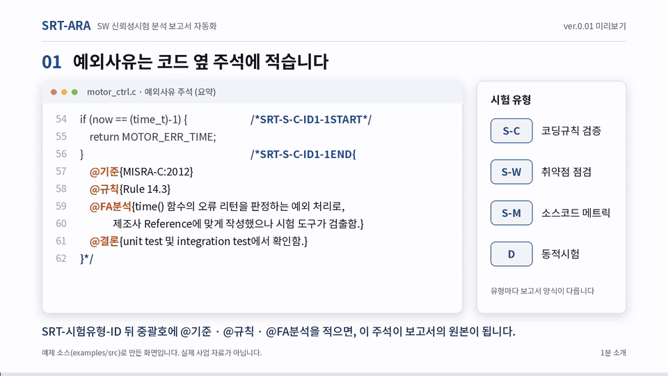

# SRT-ARA — SW 신뢰성시험 분석 보고서 자동화 도구

**SRT-ARA**: Software Reliability Test – Analysis Report Automation. 지금 버전은 **ver.0.01**이다
(화면 왼쪽 위와 `python -m srtgen --version`에 보인다. 버전별 내용은 [CHANGELOG.md](CHANGELOG.md)).
명령·파일에 쓰는 내부 이름은 `srtgen`이다(`python -m srtgen`, `srtgen.bat`, 프로젝트 폴더의 `srtgen.json`).

소스코드 주석으로 적은 예외사유 표기법(`SRT-...`)을 읽어, 「무기체계 소프트웨어 개발 및 관리 매뉴얼」
부록 7 양식의 SW 신뢰성 시험 예외사유 보고서를 **md**와 **hwpx**로 생성한다.
「무기체계 소프트웨어 신뢰성 시험에서 예외사유의 효율적 관리 방안」(2018)의 예외사유 보고서
생성기를 구현한 것이다.

## 1분 소개



*예제 소스(`examples/src`)로 띄운 화면과 만든 보고서를 재구성한 1분 사용 예시다. 실제 사업 자료가 아니다.*

## 사용법

```bash
python -m srtgen examples/src -o examples/out
```

예제 보고서(`examples/out/`)는 저장소에 넣지 않았다. 위 명령으로 바로 만들어 보면 된다(코드를 그림으로 넣은 판은
`python -m srtgen examples/src -o examples/out_image --code image --compact`).

| 옵션 | 내용 |
|---|---|
| `-o`, `--out` | 출력 폴더 (기본: 프로젝트 폴더의 `srt_report/`, `srtgen.json`의 `"출력 폴더"`로 바꿈) |
| `--issue [메모]` | 만든 보고서를 새 판으로 보관하고 지난 판과 비교한 변경내역을 남김 (아래 ‘판 보관’) |
| `--project`, `--csci`, `--csc` | 보고서 제목에 쓰는 사업명, CSCI명, CSC명. 주지 않으면 프로젝트 폴더의 `srtgen.json`에서 읽는다(아래 ‘보고서 정보’). `--csci ""`이면 CSCI명을 뺀다 |
| `--format md,hwpx` | 출력 형식 (기본 둘 다) |
| `--code text\|image` | 코드내용을 글자로 발췌할지, 캡처 그림으로 넣을지 (기본 `text`) |
| `--compact` | hwpx에서 예외사유마다 쪽을 나누지 않음 |
| `--exclude PATTERN` | 제외할 파일 패턴 |
| `--encoding` | 소스 인코딩 (기본: UTF-8, 실패하면 CP949) |
| `--strict` | 경고도 실패로 처리 |
| `--folder` | 폴더에 프로젝트 파일이 있어도 폴더의 모든 소스(하위 폴더 포함)를 대상으로 함 |

## 보고서 정보 (보고서 제목)

보고서 제목은 사업명, CSCI명, CSC명을 이어 쓴다(양식 예시 "OOO체계개발사업 OOOO분석장치 운용 CSC").
이 값은 **연 프로젝트 파일이 있는 폴더**(폴더를 열었으면 그 폴더, 소스 파일만 골랐으면 첫 파일의 폴더)의
`srtgen.json`에 둔다. 소스와 함께 형상관리하면 다른 PC, 다른 사람이 만들어도 같은 제목이 나온다.

```json
{
  "사업명": "OOO체계개발사업",
  "CSCI명": "OOOO분석장치",
  "CSC명": "운용 CSC"
}
```

- 화면: `srtgen.json`이 없는 프로젝트를 처음 열면 입력 창이 뜬다("나중에"로 미룰 수 있다). 위쪽 프로젝트 메뉴의
  "보고서 제목 바꾸기…"나 "3 보고서 만들기" 화면의 "바꾸기…"로 언제든 바꾸며, 저장하면 그 파일에 쓴다. 사업명과 CSC명은 꼭 적어야 하고 CSCI명은 비워 둘 수 있다.
- 명령줄: 옵션(`--project`, `--csci`, `--csc`) > `srtgen.json` > 기본값(양식 예시의 OOO) 순서로 정한다. 명령줄은 파일을 쓰지 않는다.
- 제목에 양식 예시 값(`OOO체계개발사업`처럼 `OOO`, `○○`)이 남아 있으면 보고서를 만들 때 알린다(명령줄은 경고, 화면은 프로젝트 단추의 아랫줄과 "3 보고서 만들기" 화면).
- 파일에 다른 항목을 적어 두어도 화면에서 저장할 때 지우지 않고 그대로 둔다. JSON 형식이 깨진 파일은 덮어쓰지 않고 알린다(명령줄은 경고 후 기본값).

## 여러 사업·프로젝트와 형상관리

개인 PC에서 혼자 쓰는 도구다. 폐쇄망 PC에서 그대로 돌고(기본 기능은 Python 표준 라이브러리만 쓰고 인터넷·서버가 필요 없다. 아래 ‘폐쇄망 PC에 설치’),
인터넷이 되는 PC에서도 같은 방식으로 쓴다.
개발자 한 사람이 여러 사업·프로젝트를 맡는 경우를 위해 다음을 둔다.

- **프로젝트 목록**: 화면에서 연 프로젝트가 자동으로 들어가고, 사업명 → CSCI명 → CSC명으로 묶어 보인다.
  예외사유·오류 수, 마지막으로 연 때, 마지막 보고서(판 번호)를 함께 보이고, 눌러서 바로 연다. 위쪽 프로젝트 메뉴(최근 5개와
  "프로젝트 목록 전체…")와 첫 화면에서 본다. 목록은 사용자 폴더의 `.srtgen/projects.json`에 있고(`--projects`로 바꿈), 목록에서 빼도 프로젝트 폴더의 파일은 지워지지 않는다.
- **출력 폴더**: 보고서는 프로젝트마다 그 폴더 안의 `srt_report/`에 만든다. 프로젝트를 바꿔 열어도 섞이지 않고,
  소스·`srtgen.json`·그림(`srt_attach/`)과 함께 사업의 형상관리 도구(SVN, Git 등)로 관리할 수 있다.
- **판 보관**: "3 보고서 만들기" 화면에서 "새 판(vN)으로 보관"을 고르면(명령줄은 `--issue "메모"`) 출력 폴더의
  `이력/v<번호>_<날짜-시각>/`에 그 보고서 묶음과 `변경내역.md`가 남는다. 변경내역은 지난 판과 비교해 추가·변경·삭제된
  예외사유와 무엇이 바뀌었는지(내용 항목, 개수, 발생 위치, 코드)를 적는다. 줄 번호만 바뀐 것은 변경으로 보지 않는다.
  판 목록은 `이력/이력.json`이고 화면의 "판 이력"에서 본다. 새 판으로 보관하지 않고 만들면 출력 폴더 맨 위의 파일만 바뀐다.

```text
<프로젝트 폴더>/
  FCS.sln, *.c ...
  srtgen.json              보고서 정보(사업명, CSCI명, CSC명), 출력 폴더
  srt_report/              마지막으로 만든 보고서
    이력/
      이력.json            판 목록
      v1_20261014-134726/  그 판의 보고서 묶음 + 변경내역.md
      v2_20261020-091502/
```

## 대상: 프로젝트 파일, makefile, 폴더, 소스 파일

명령줄과 화면 모두, 대상으로 다음을 섞어 줄 수 있다. 프로젝트 파일을 주면 **그 프로젝트에 속한 소스만**
읽고, 개발도구에서 보이는 구조(필터, 그룹)대로 트리를 만든다.

**폴더를 고르면** 그 폴더 바로 아래에 프로젝트 파일이 있는지 본다.

- 있으면 프로젝트 파일로 연다. 화면에서는 무엇으로 열지 고르게 하고(권장 표시), 명령줄은 권장하는 것으로 연다.
  권장 순서는 솔루션·작업 공간(`.sln`, `.atsln`, `.eww`) → 프로젝트(`.vcxproj`, `.csproj`, `.ewp`, `.uvprojx` 등)
  → Eclipse 계열(`.project`) → `CMakeLists.txt` → `Makefile` → `pom.xml` → Gradle이다.
  `*.mk`, `*.mak`는 다른 makefile이 불러 쓰는 조각인 경우가 많아 권하지 않는다(직접 고르면 열린다).
- 없으면 폴더의 모든 소스(하위 폴더 포함)를 연다. 프로젝트 파일이 있어도 폴더 전체를 보려면 화면에서
  "폴더의 모든 소스로 열기"를 고르거나 명령줄에 `--folder`를 준다.

화면 위쪽 프로젝트 메뉴의 "폴더 열기…"를 누르면 파일 탐색기 모양의 폴더 선택 창이 뜬다. 목록에서 고르려면
"목록에서 고르기…"를 누른다. 목록에서는 폴더를 한 번 눌러 고르고 "고른 폴더 열기"를 누른다(두 번 누르거나 › 를 누르면
그 폴더 안으로 들어간다. 고른 폴더가 없으면 지금 보고 있는 폴더를 연다).

```bash
python -m srtgen examples/src/fcs.mk -o out            # makefile 의 소스 구성대로
python -m srtgen app.sln logger/.project -o out        # 프로젝트 여러 개
python -m srtgen src/a.c src/b.c -o out                # 소스 파일만 골라서
```

| 대상 | 읽는 것 | 트리 구조 |
|---|---|---|
| Visual Studio `.sln`, `.vcxproj`, `.csproj` | 컴파일/헤더 항목. `.sln`은 그 안의 C/C++, C# 프로젝트 | `.vcxproj.filters`가 있으면 필터, 없으면 폴더 |
| Microchip(Atmel) Studio `.atsln`, `.cproj`, `.cppproj` | 컴파일 항목(소스·헤더), 연결한 외부 파일 | 폴더 |
| Eclipse 계열 `.project`, `.cproject`, `.ccsproject`, `.classpath` (Code Composer Studio, Xilinx SDK/Vitis, CDT, Wind River Workbench, Java) | 프로젝트 폴더의 소스. 빌드 제외 항목, 소스 폴더 설정, 연결된 리소스(경로 변수 포함), 리소스 필터 반영 | 폴더(연결된 폴더는 프로젝트에서 붙인 이름) |
| `Makefile`, `*.mk` | 변수와 규칙에 나오는 소스·오브젝트 이름. `include`, `VPATH`, 하위 폴더 make 따라감 | 폴더 |
| `CMakeLists.txt` | `add_executable`, `add_library`, `target_sources`, `add_subdirectory` | 대상(target) 아래 폴더 |
| IAR `.ewp`, `.eww` / Keil `.uvprojx`, `.uvproj` | 그룹과 파일 | 그룹 |
| Maven `pom.xml` / Gradle | 소스 폴더(관례 또는 설정값), 하위 모듈 | 폴더 |
| 폴더 | 폴더 아래의 모든 소스 | 폴더 |
| 소스 파일 | 고른 파일만 | "선택한 파일" |

- 빌드 도구를 실행하지 않고 파일만 읽는다. makefile의 `$(shell ...)`처럼 실행해야 정해지는 소스는 빠질 수 있고,
  그런 경우 경고를 남긴다(화면에서는 프로젝트를 누르면 보이고, 요약 파일에도 적힌다).
- 모든 형식은 규격에 맞춰 만든 시험용 프로젝트로 확인했다. 개발도구가 실제로 만든 파일로 확인한 범위는 아래
  ‘알려진 한계’에 적었다. 쓰는 개발도구의 프로젝트로 한 번 열어 트리가 맞는지 보는 것이 좋다.
- 보고서의 파일명은 개발도구에서 보이는 이름이다. Eclipse 계열(CCS 등)·C#·Microchip Studio는 프로젝트 안의 이름(`FreeRTOS/tasks.c`),
  Visual Studio는 솔루션 탐색기의 필터 경로(`FreeRTOS Source/Source/tasks.c`), IAR·Keil은 그룹 경로다.
  실제 위치(`../../Source/tasks.c`)가 아니다. 같은 자리(폴더·필터·그룹)에 이름이 같은 파일이 둘이면 뒤의 것에 실제 경로를 덧붙인다
  (`Source/io.c [b/io.c]`). 필터 파일이 없는 Visual Studio 프로젝트와 makefile, CMake, 폴더는 실제 상대 경로를 쓴다.
- 예외사유 ID는 함께 연 범위 안에서 하나로 본다. 서로 다른 SW(CSC)는 따로 연다. 함께 열면 같은 ID가 동일사항으로 묶인다.
- 일부 파일만 열면 대표 위치(내용을 쓴 곳)가 빠져 "내용 없음" 경고가 날 수 있다.

## 확인·편집 화면

도구 폴더의 `srtgen.bat`을 두 번 누르면 화면이 뜬다(첫 화면에 프로젝트 목록). 폴더나 프로젝트 파일을
`srtgen.bat`에 끌어다 놓으면 그것을 연다. 명령으로 띄울 때는 다음과 같다.

```bash
python -m srtgen serve examples/src -o examples/out
```

화면 위쪽은 왼쪽에서 오른쪽으로 **쓰는 순서**대로 놓여 있다. 숫자 순서대로 쓰면 된다.

| 위치 | 하는 일 |
|---|---|
| **프로젝트** ▾ | 지금 연 프로젝트(CSC명과 사업명 / CSCI명)를 보이고, 누르면 최근 프로젝트, 프로젝트 목록 전체, 폴더 열기, 목록에서 고르기, 소스 다시 읽기, 보고서 제목 바꾸기가 나온다 |
| **1 잘못 쓴 주석 고치기** | 잘못 쓴 예외사유 주석을 모아 그 자리에서 고친다(저절로 고치지 않고 "소스에 반영"을 눌러야 저장된다). 단추에 오류·경고 수(없으면 ✓)가 보인다 |
| **2 예외사유 검토·편집** | 왼쪽 트리에서 범위를 고르고 예외사유를 눌러 내용을 고쳐 소스에 반영한다(프로젝트를 열면 처음 보이는 화면). 단추에 예외사유 수와 반영하지 않은 편집 수가 보인다 |
| **3 보고서 만들기** | 제목·형식·출력 폴더를 확인하고 md/hwpx를 만든다. 판 보관과 판 이력도 여기 있다. 단추에 마지막 판 번호가 보인다. 출력 폴더 경로(📂)와 판 이력의 "폴더"를 누르면 그 폴더가 파일 탐색기로 열린다(출력 폴더와 그 아래만) |
| **설정** ▾ | 드물게 쓰는 것: 규칙 목록, 프로젝트 목록 관리, 정보 |

- 잘못 쓴 주석의 오류가 남아 있으면 2·3단계 화면 위에 알리고 "1 잘못 쓴 주석 고치기로" 단추를 보인다(막지는 않는다).
  각 화면 아래의 "다음: …" 단추로 다음 단계로 넘어간다.
- 개발도구에서 소스나 프로젝트 파일을 고치고 이 창으로 돌아오면 바뀐 것을 알아채 저절로 다시 읽는다.
  화면에서 고치던 편집은 그대로 둔다.
- 대상 없이 `python -m srtgen serve`만 실행하고 화면에서 열어도 된다. 프로젝트 메뉴의 "폴더 열기…"는 폴더 선택 창으로 폴더를,
  "목록에서 고르기…"는 목록에서 프로젝트 파일, makefile, 폴더, 소스 파일을 고른다. "지금 연 것에 추가"로 여러 개를 함께 볼 수 있다.
- 폴더 선택 창은 Python에 들어 있는 tkinter로 띄운다(python.org의 Windows용 설치 파일로 설치한 Python에는 기본으로 들어 있다). 창을 띄울 수 없는
  환경이면 안내가 나오고 목록에서 고르면 된다.
- 트리의 숫자는 그 아래에 있는 예외사유 주석 수이다. 예외사유가 없는 파일은 흐리게 나오고, 왼쪽 위의
  "예외사유가 있는 파일만 보기"를 켜면 숨긴다.
- **정보**(설정 ▾ → 정보…): "소프트웨어 정보" 탭에 이름·버전·따르는 시험 기준·바탕 논문·저작권과 실행 환경(Python,
  Pillow·Pygments·Mermaid 유무, 규칙 목록·프로젝트 목록 파일 위치)이, "오픈소스 정보" 탭에 함께 넣은 외부 소프트웨어·자료의
  버전·라이선스·받은 곳과 고지 전문, 변경 이력이 나온다. 오픈소스 목록은 [THIRD_PARTY.md](THIRD_PARTY.md)를 읽어 보인다.
- 도구를 새 버전으로 바꿨는데 예전에 띄운 화면 서버가 돌고 있으면, 화면 맨 위에 "srtgen.bat을 다시 실행하십시오"가 뜬다.
  검은 콘솔 창을 닫고 `srtgen.bat`을 다시 두 번 누르면 된다.

- 왼쪽 창 위쪽의 분류 단추는 시험 유형의 정식 명칭(정적시험-코딩규칙 검증, 정적시험-취약점 점검, 소스코드 메트릭 점검, 동적시험)으로 보인다.
- **근거자료(그림·다이어그램)**: 편집 화면에서 그림 파일을 올리거나 Mermaid로 순서도·순서 다이어그램·상태 전이도를 그려 넣는다.
  파일은 소스 파일 옆의 `srt_attach/` 폴더에 저장되고(다이어그램은 그림 `.png`와 원본 `.mmd`), 주석에는 `@첨부`로 경로만 적힌다.
  다이어그램으로 만든 그림은 나중에 다시 고칠 수 있다.
- **1 잘못 쓴 주석 고치기**: 잘못 쓴 예외사유 주석(소문자, 밑줄, 빈칸, 오타, 짝이 안 맞는 START/END, 모르는 항목 등)을 주석별로 모아 보여 준다.
  "주석 고치기"로 그 주석의 원문을 고쳐 소스에 반영하며, 고칠 수 있는 것은 제안을 눌러 바로 바꿀 수 있다.
  이때도 주석 밖의 코드가 달라지면 반영하지 않는다.
- 내용 편집에서 고칠 수 있는 것은 `@항목`의 내용이다. 태그의 위치, ID, 범위(START/END)는 소스나 "1 잘못 쓴 주석 고치기"에서 고친다.
- 대표 위치에서는 그 유형의 모든 항목을, 동일사항 위치에서는 위치별 항목(`@비고`, `@측정값`)을 고친다.
- 소스에 반영할 때는 주석만 바꾼다. 저장 전에 주석을 뺀 코드가 그대로인지, 다시 읽은 내용이 입력과 같은지,
  다른 예외사유가 그대로인지 확인하고 하나라도 어긋나면 파일을 쓰지 않는다.
- 바뀐 항목만 고친다. 손대지 않은 항목의 줄바꿈과 순서, 파일의 인코딩과 줄바꿈 형식은 그대로 둔다.
- 반영하는 순간 소스가 다른 곳(편집기 등)에서 바뀌어 있으면 덮어쓰지 않고 거부한다. 이 창으로 돌아오면 저절로
  다시 읽으므로 다시 반영하면 된다(프로젝트 메뉴의 "소스 다시 읽기"로 직접 읽을 수도 있다).
- 이 PC(127.0.0.1)에서만 접속할 수 있고, 소스 파일은 수집한 것만 고친다. 그 밖에 쓰는 파일은 소스 옆의 `srt_attach/`, `srtgen.json`, 출력 폴더, 사용자 폴더의 규칙 목록·프로젝트 목록뿐이다.

| 옵션 | 내용 |
|---|---|
| `--port` | 접속 포트 (기본: 8765부터 비어 있는 포트) |
| `--no-browser` | 브라우저를 자동으로 열지 않음 |
| `--rules FILE` | 직접 넣는 규칙 번호·규칙명 목록 파일 (기본: 사용자 폴더의 `.srtgen/rules.json`) |
| `--projects FILE` | 프로젝트 목록 파일 (기본: 사용자 폴더의 `.srtgen/projects.json`) |

## 출력

| 파일 | 주석 모양 | 양식 |
|---|---|---|
| `01_코딩규칙_FA사유서` | `SRT-S-C-ID##` | 부록 7-24 |
| `02_취약점_FA사유서` | `SRT-S-W-ID##` | 부록 7-24 |
| `03_소스코드메트릭_미달성분석보고서` | `SRT-S-M-ID##` | 부록 7-25 |
| `04_동적시험_미달성분석보고서` | `SRT-D-ID##` | 부록 7-26 |
| `00_예외사유_요약.md` | 전체 | 소스 구성(읽은 곳은 출력 폴더 기준 상대 경로), 따르는 시험 기준과 도구 버전, 유형별 건수, 예외사유 목록, 점검 결과(잘못 쓴 예외사유 주석) |
| `exceptions.json` | 전체 | 추적용 데이터. 맨 위 `"기준"`에 매뉴얼 판과 도구 버전 |

표기법은 [docs/예외사유_표기법.md](docs/예외사유_표기법.md), 표기 예는 [examples/src](examples/src)를 본다.

## 시험 기준

도구가 따르는 시험 기준은 「무기체계 소프트웨어 개발 및 관리 매뉴얼」 방위사업청 매뉴얼 제2024-6호(개정 2024.12.26.) 부록 7의
'3. 시험 기준'이다(매뉴얼 원문은 저장소에 넣지 않는다). 기준은 `srtgen/criteria.py` 한 곳에 있다.

**매뉴얼 개정 대응**: 도구 한 버전은 매뉴얼 한 판을 따르고, 매뉴얼이 개정되면 도구 버전을 올려 대응한다
(버전별 기준: [CHANGELOG.md](CHANGELOG.md)).
지금 따르는 판은 `python -m srtgen --version`과 화면의 "3 보고서 만들기"에서 볼 수 있다. 산출물(`exceptions.json`, 요약)과
판 이력에 매뉴얼 판과 도구 버전이 적히므로, 개정 뒤에도 지난 보고서를 어느 기준으로 만들었는지 알 수 있다.
옛 판을 계속 따라야 하는 사업은 옛 버전 도구를 쓴다.

| 시험 | 표기법 | 기준에 따라 하는 일 |
|---|---|---|
| 코딩규칙 검증 | `@기준{MISRA-C:2012} @규칙{Rule 14.3} @FA내용{규칙명}` | 매뉴얼에 있는 코딩 규칙 기준인지 점검하고, 양식의 코딩규칙 칸에 기준과 규칙 번호를, FA내용 칸에 규칙명을 적는다. 도구에 목록이 든 기준(C# Coding Conventions의 IDE0001, .NET Framework Design Guidelines의 CA1000 등)은 번호만 적으면 규칙명을 채운다. 그 밖의 기준은 규칙명을 직접 적거나 규칙 목록에서 고른다 |
| 취약점 점검 | `@취약점{CWE-476}` | CWE 번호가 있는지 점검하고, FA내용을 비워 두면 CWE 이름으로 채운다(CWE-658/659/660과 보안약점 점검 목록. 목록에 없는 CWE는 `@취약점{CWE-667 Improper Locking}`처럼 번호 뒤에 적은 이름) |
| 소스코드 메트릭 | `@메트릭{…}` | 매뉴얼 예시의 메트릭 종류를 화면에서 고를 수 있다(메트릭 종류와 값은 점검하지 않음) |
| 동적시험 | `@커버리지{분기}` | 문장·분기·MC/DC 중 하나인지 점검하고, 양식의 미달성 사유 칸에 실행률 기준을 적는다 |

요약 파일(`00_예외사유_요약.md`)에 시험 기준별 건수가 나온다.

근거는 규칙 번호와 규칙명까지만 다룬다. 규칙 분석(코드가 규칙을 어겼는지 판단)은 하지 않는다.

**규칙 목록**: 화면 오른쪽 위 설정 메뉴의 "규칙 목록…"에서 기준을 고르면 도구에 든 번호·이름 목록을 보고 번호나 이름으로
찾을 수 있다. 코딩 규칙 기준(C# Coding Conventions, .NET Framework Design Guidelines)과 취약점 점검 목록
(CWE-658/659/660, 보안약점 점검 목록)이 있고, 취약점 목록은 보기만 한다. 목록이 없는 기준은 그 까닭이 나온다
(MISRA는 구매 문서. C++ Core Guidelines와 Java Code Conventions는 라이선스가 내부 사용만 허락해 공개본에 넣지 않았다). 목록마다 버전(판·문서 날짜)과 가져온 곳(URL)·받은 날이 함께 보인다.
도구에 목록이 들어 있지 않은 기준(MISRA 등)은 같은 창에서 규칙 번호와 규칙명을 직접 넣어 둘 수 있다. 넣는 방법은 셋이다.

- **한 줄 더하기**: 번호와 규칙명 칸에 적고 "한 줄 더하기"(또는 Enter).
- **파일에서 불러오기**: CSV(쉼표·세미콜론·탭)나 TXT. CSV는 "번호"·"규칙명" 머리줄이 있으면 그 열을, 없으면 앞의 두 열을 읽는다.
  엑셀에서는 "CSV(쉼표로 분리)"로 저장하면 된다(UTF-8과 CP949 모두 읽는다). TXT는 한 줄에 `번호<탭>규칙명` 또는 `번호: 규칙명`.
- **직접 적기**: 아래 칸에 한 줄에 하나씩 적거나 표에서 붙여 넣는다.

같은 번호는 새것으로 바뀌고, 읽지 못한 줄은 줄 번호를 알려 준다. 불러오거나 더한 뒤 "저장"을 눌러야 저장된다.
직접 넣은 목록에도 버전(예: MISRA C:2012 Amendment 4)과 가져온 곳(URL·문서)을 적어 둘 수 있다.
넣어 둔 규칙은 코딩규칙 예외사유를 편집할 때 번호로 고를 수 있고, 고르면 규칙명이 함께 들어간다.
번호만 적혀 있고 규칙명이 빈 경우에는 "규칙명 채우기" 단추가 나온다. 연 소스에 이미 적혀 있는 번호·규칙명도
선택지에 나온다. 목록은 사용자 폴더의 `.srtgen/rules.json`에 저장되며(`--rules 파일`로 바꿀 수 있음),
규칙명은 고를 때 소스 주석에 적히므로 이 파일이 없는 PC에서도 보고서는 같게 나온다.
CWE(MITRE), C# Coding Conventions(.NET 코드 스타일 규칙 IDE 130개), .NET Framework Design Guidelines(.NET 코드 분석
규칙 CA·IL 335개)는 공개된 목록에서 번호와 이름만 넣어 두었다([THIRD_PARTY.md](THIRD_PARTY.md)).
MISRA C/C++(구매 문서, 1인 사용 허락, 공개된 규칙명 목록 없음), C++ Core Guidelines(개인·내부 업무용만),
Java Code Conventions 목차(비상업·내부 사용만)는 라이선스상 넣지 않았다. 이 기준들은 원본을 보고 위 방법으로 규칙 목록에
넣어 쓴다(각자의 사용 조건을 지킨다).

## 요구 사항

- Python 3.9 이상. Windows에서 Python 3.9.13, 3.12.10, 3.14.5로 시험 전체가 통과했다.
  md, hwpx 생성과 확인·편집 화면은 표준 라이브러리만 쓴다(화면도 외부 접속 없이 동작한다).
  한글 프로그램은 필요 없다(생성한 hwpx는 한글2024에서 열리는 것을 확인했다).
- `--code image`는 Pillow가 필요하고, Pygments가 있으면 구문 강조를 한다.
- 화면의 "다이어그램 추가"는 함께 넣어 둔 Mermaid(`srtgen/web/vendor/mermaid.min.js`, MIT)를 쓴다.
  배포할 때 [THIRD_PARTY.md](THIRD_PARTY.md)와 `licenses/`를 함께 넣는다. Mermaid 파일(`mermaid.min.js`)을 빼도 다이어그램 추가 말고는 그대로 동작한다.
- 대상 언어: C, C++, Java, C#. 주석으로 표현할 수 있는 언어는 `srtgen/lexer.py`의 `LANGUAGES`에 추가한다.

## 폐쇄망 PC에 설치

도구의 모든 기능은 인터넷 없이 돈다. 방법은 둘이다.

### 방법 1: 폐쇄망용 묶음 (권장)

Release에 함께 올린 **`SRT-ARA_ver<버전>_offline.zip`**(약 30MB) 하나만 옮긴다. 휴대용 Python 3.14(Tcl/Tk 포함)와
Pillow·Pygments가 도구 폴더의 `python/`에 미리 들어 있다.

1. zip을 폐쇄망 PC의 아무 폴더에 푼다(경로에 한글·빈칸이 있어도 된다).
2. `srtgen.bat`을 두 번 누른다. PC에 Python이 없어도 되고, 설치·관리자 권한·인터넷이 필요 없다.

Windows 10 이상 64비트용이다(Windows 10에서는 아직 돌려 보지 않았다). 함께 든 것의 버전·출처·검증값·라이선스는 zip 안의 `폐쇄망용_안내.txt`와
[THIRD_PARTY.md](THIRD_PARTY.md)의 "폐쇄망용 묶음에만 들어가는 것"에 있다.

### 방법 2: PC에 Python 설치

인터넷이 되는 PC에서 아래를 받아 옮겨 온다.

1. **이 도구**: 받은 폴더(또는 zip을 푼 폴더)를 통째로 복사한다. 설치 과정은 없다.
2. **Python 3.9 이상**: python.org의 Windows 설치 파일(installer)을 받아 설치한다.
   - 설치 화면의 "tcl/tk and IDLE"은 켜 둔다(기본으로 켜져 있다). 화면의 폴더 선택 창에 쓴다. 꺼져 있거나 임베드 판(zip)을
     쓰면 폴더 선택 창 대신 "목록에서 고르기" 창으로 연다.
   - "Add python.exe to PATH"는 켜지 않아도 된다. `srtgen.bat`은 도구 폴더의 `python\python.exe`(방법 1), PC의 `python`,
     `py -3` 순서로 실제로 실행해 보고 되는 것을 쓴다(Windows의 `python` 실행 별칭은 Microsoft Store로 연결될 뿐 돌지
     않으므로 건너뛴다). 모두 안 되면 안내를 띄운다.
3. **(선택) Pillow·Pygments**: `--code image`(코드를 그림으로)에만 쓴다. 없으면 글자 발췌로 만든다. 넣으려면 인터넷 PC에서
   같은 Python 버전으로 `py -m pip download Pillow Pygments -d wheels`로 받아 옮긴 뒤, 폐쇄망 PC에서
   `py -m pip install --no-index --find-links wheels Pillow Pygments`로 설치한다.

브라우저는 Windows에 들어 있는 Edge 등을 그대로 쓴다. 화면은 이 PC의 `127.0.0.1`에만 접속한다. 회사 프록시 설정 때문에
화면이 열리지 않으면 프록시 예외에 `127.0.0.1`을 넣는다. 인터넷이 없을 때 안 되는 것은 화면에 적힌 출처 링크(CWE, Microsoft
문서 등)를 여는 것뿐이다.

확인한 방법(2026-10-15): 추가 패키지가 없는 Python 3.9(임베드 판)에서 바깥 연결을 모두 막고 시험 전체, 보고서 만들기(글자·그림
방식, 판 보관), 화면 서버를 돌렸고, 바깥 주소를 찾지 못하게 한 브라우저로 화면을 한 바퀴(1·2·3단계, 양식 미리보기, 다이어그램,
규칙 목록, 정보 창, 보고서 만들기) 돌렸다. 폐쇄망용 묶음은 한글·빈칸·괄호가 든 경로에 풀어, PATH에 Python이 하나도 없는
상태에서 `srtgen.bat`이 묶음의 Python으로 뜨는 것과, 묶음의 Python으로 시험 전체·코드 그림 보고서·화면 한 바퀴를 같은 조건(바깥
연결 막음)으로 확인했다. 바깥으로 나간 요청은 없었다.

## 알려진 한계 (ver.0.01, 미리보기)

ver.0.01은 **미리보기 판**이다. 주석 수집부터 보고서 생성까지 기능은 갖췄지만 실제 사업 프로젝트에서 쓰며 검증하기 전이다.
만든 보고서는 제출하기 전에 직접 확인한다. 쓰다가 문제를 발견해 알려 주면 고친다.

- **시험 도구의 반응**: 표기법 주석 자체(중괄호·세미콜론이 든 주석)를 정적 분석 도구가 위반(예: 주석 처리된 코드)으로
  검출하는지 확인하지 않았다. 쓰는 시험 도구로 [examples/src](examples/src)의 파일 하나를 먼저 검사해 보기를 권한다.
  (주석 안의 `//`·`/*`는 수집할 때 경고한다.)
- **개발도구 프로젝트 해석**: 개발도구가 실제로 만든 파일로 확인한 것은 Code Composer Studio 프로젝트 하나와
  Visual Studio C/C++ 프로젝트 하나(둘 다 공개된 FreeRTOS 데모), CMake의 항목 해석까지다. Microchip(Atmel) Studio, Xilinx,
  IAR, Keil, makefile, C# 프로젝트는 규격에 맞춰 만든 시험용 프로젝트로만 확인했다. Xilinx Vitis의 새 통합 IDE 형식과
  MPLAB X는 지원하지 않는다. 쓰는 프로젝트로 한 번 열어 트리와 파일명이 개발도구와 같은지 본다.
  두 FreeRTOS 데모는 실제 소스(FreeRTOS 202411.00)에 표기법 주석을 달아 보고서 생성·한글2024로 열기·화면에서 되쓰기·줄 밀림 뒤
  다시 만들기까지 한 바퀴 돌려 보았다. 개발도구 화면과 직접 대조하지는 않았다.
- **실행 환경**: Windows 11에서 확인했다. 시험 전체는 Python 3.9.13, 3.12.10, 3.14.5와 폐쇄망용 묶음의 3.14.8에서
  통과했고, 화면과 실제 사용은 3.14에서만 해 봤다. 폐쇄망용 묶음은 Windows 10 이상 64비트용이며 Windows 10에서는 돌려 보지
  않았다. Linux·macOS는 확인하지 않았다(`srtgen.bat`은 Windows용, 폴더 선택 창은 tkinter).
  `srtgen.bat`에 폴더를 끌어다 놓아 여는 것은 직접 확인하지 않았다.
- **hwpx**: 한글2024에서 열리는 것을 확인했다. 다른 한글 버전과 뷰어는 확인하지 않았다. 양식의 열 너비·글꼴은
  매뉴얼 PDF를 보고 맞춘 근사치이고, 기관이 쓰는 실제 양식 파일의 서식은 아직 반영하지 않았다.
- **규모**: Java 30만 줄·C 18만 줄의 실제 소스로 발췌 위치를 확인했다. C++·C#은 수백 줄 규모로만 확인했다.
  소스가 수천 개인 프로젝트에서 화면으로 돌아올 때 다시 읽는 시간은 재지 않았다.
- **규칙 목록**: .NET·C# 규칙 번호와 이름은 목록을 받은 때의 Microsoft 문서 기준이다(문서 날짜는 규칙 목록 창에 보인다). 사업에서 쓰는 시험 도구가 보고하는 번호 체계와
  같은지는 확인하지 않았다. 규칙 분석(코드가 규칙을 어겼는지 판단)은 하지 않는다.
- **형상관리**: 판 보관과 변경내역은 도구가 출력 폴더 안에서 하는 것이고, SVN·Git의 리비전은 읽지 않는다. Git 작업 사본에서 되쓴 차이가 주석 줄뿐이고 줄바꿈 형식(CRLF/LF)이
  그대로인 것은 확인했다. 커밋한 것을 다른 PC에서 받아 같은 결과가 나오는지는 확인하지 않았다.

## 라이선스

SRT-ARA의 도구 코드는 MIT 라이선스다([LICENSE](LICENSE)). 함께 넣은 외부 소프트웨어와 자료(Mermaid, CWE 목록,
.NET 규칙 목록)는 MIT가 아니라 각자의 조건을 따른다([THIRD_PARTY.md](THIRD_PARTY.md), `licenses/`).
시험 기준·양식의 원문(방위사업청 매뉴얼)과 바탕 논문은 저장소에 넣지 않는다. 매뉴얼은 방위사업청에서 구한다.
